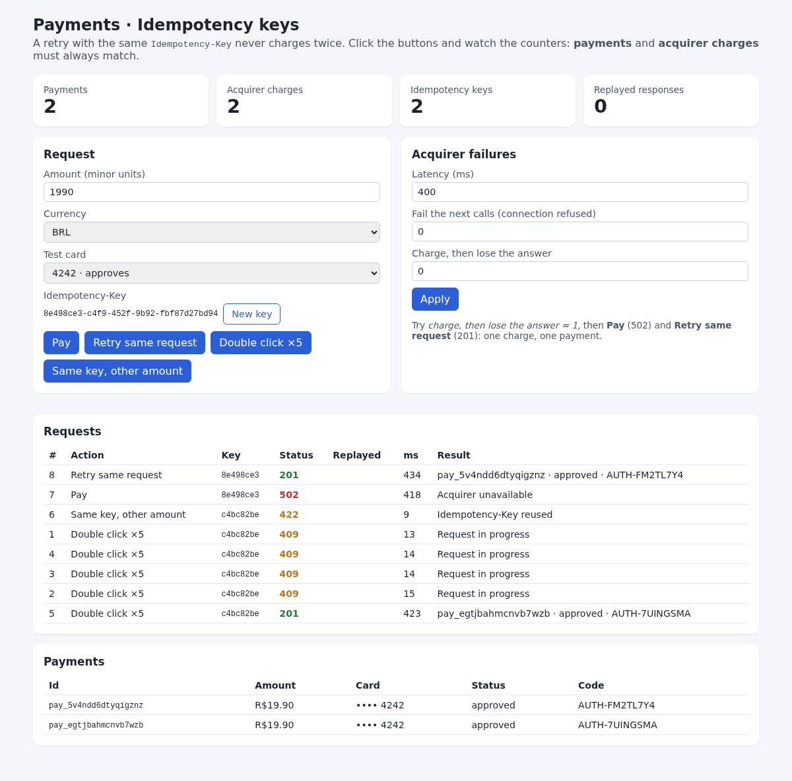
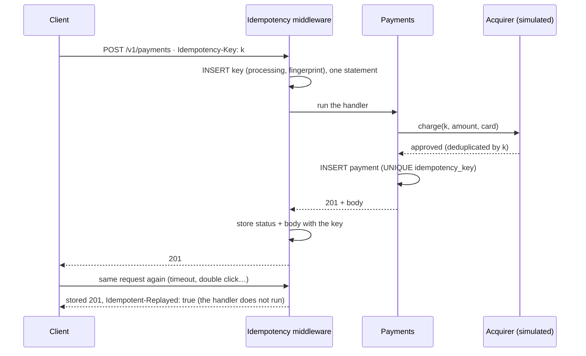

# Payments · Idempotency Keys

[](https://github.com/edybackend/payments-idempotency/actions/workflows/ci.yml)
[Leia em português](README.pt-BR.md)

A payment API in **Go** where a retry can never charge a card twice. Clients send an `Idempotency-Key`, the way Stripe's
API works:
- the server executes the request once and replays the stored response afterwards;
- it answers `409` while the first request is still running;
- it refuses the same key with a different body (`422`);
- it takes over a key left behind by a crashed request.

The key also travels to the (simulated) card acquirer. If the answer is lost *after* the money moved, the retry still finds
the same charge. A **React** panel embedded in the binary lets you click through every case.



## Quick start

Requirements: Docker.

```bash
docker compose up --build
```

Open http://localhost:8080. Then:
- **Double click ×5**: five concurrent requests, one execution.
- **Same key, other amount**: `422`.
- Set *charge, then lose the answer* to 1, click **Pay** (`502`), then **Retry same request** (`201`). There is one charge, not two.

<details>
<summary>Without Docker (Go 1.27 + Node 24)</summary>

```bash
cd web && npm ci && npm run build && cd ..   # optional: without it the API runs and / shows a note
go run ./cmd/payments                        # http://localhost:8080
```

```bash
curl -i -X POST localhost:8080/v1/payments \
  -H 'Content-Type: application/json' -H 'Idempotency-Key: order-42' \
  -d '{"amount":1990,"currency":"BRL","card":"4242 4242 4242 4242","description":"Concert ticket"}'
# run it again → same body, header "Idempotent-Replayed: true"
```
</details>

## How it works



| The key is… | Answer |
|---|---|
| new | execute, then store the response |
| finished, same request | **replay** the stored status and body, `Idempotent-Replayed: true` |
| still running | `409` + `Retry-After: 1` |
| used with a different body | `422`: a key belongs to one request (SHA-256 fingerprint of method, path and body) |
| held by a request that died (older than 30 s) | taken over with a compare-and-set, then executed |
| missing | `400` |

A `5xx` is **not** stored: the key is released so the client can retry. That is safe because the acquirer call carries
the same key, and `payments.idempotency_key` is `UNIQUE` as a last guard.

## The cases, and how each one is tested

| Case | Test |
|---|---|
| 20 concurrent requests, one key → handler runs once | `TestConcurrentRequestsWithOneKeyRunTheHandlerOnce` (`-race`) |
| 10 concurrent payments, one key → 1 payment, 1 acquirer charge | `TestADoubleClickChargesOnce` |
| Charged, answer lost → `502`; retry → `201`, still 1 charge | `TestChargedButTheAnswerWasLost` |
| Acquirer down twice → `502`, `502`, `201`, 1 charge | `TestAnUnreachableAcquirerIs502AndTheRetryWorks` |
| Same key, other body → `422`, handler not run | `TestSameKeyWithADifferentBodyIs422` |
| Key stuck in *processing* → `409`, then taken over after the timeout | `TestAKeyStuckInProcessingIsTakenOverAfterTheLockTimeout` |
| `5xx` releases the key | `TestA5xxReleasesTheKeySoTheRetryRunsAgain` |
| Through the real container | CI job `container`: 10 concurrent requests, replay header, `422`, stats = 1 payment / 1 charge |

A mutation proves the "answer lost" test is not decorative: without the acquirer's deduplication it finds 2 charges.

## API

| Method | Route | What it does |
|---|---|---|
| `POST` | `/v1/payments` | create a payment (needs `Idempotency-Key`) → `201` `approved` or `declined` |
| `GET` | `/v1/payments`, `/v1/payments/{id}` | payments (last 4 digits only) |
| `GET` | `/v1/stats` | payments, acquirer charges, keys, replays |
| `GET` / `PUT` | `/v1/chaos` | acquirer latency, fail the next calls, charge then lose the answer |
| `GET` | `/healthz` | health |

Test cards: `4242 4242 4242 4242` approves, `4000 0000 0000 0002` is declined. Amounts are integers in minor units
(`1990` = 19.90). Errors are RFC 9457 problem details.

## Tech stack

| Area | Choice |
|---|---|
| Back-end | Go 1.27, standard library `net/http` (method routing), `log/slog`, `errgroup` |
| Persistence | SQLite via `modernc.org/sqlite` (pure Go, no CGO); the acquirer has its own database |
| Front-end | React 19 + TypeScript + Vite, embedded with `go:embed` |
| Quality | table-driven tests, `-race`, golangci-lint, gofmt, oxlint |
| Delivery | three-stage image (Node → Go → distroless non-root), Docker Compose, GitHub Actions |

## Project structure

```
cmd/payments/           entry point: wiring, HTTP server, key janitor, graceful shutdown
internal/idempotency/   key store + middleware (knows nothing about payments)
internal/payments/      validation (Luhn), charge through the acquirer, one payment per key
internal/acquirer/      simulated acquirer: deduplicates by key, failure injection
internal/httpapi/       routes, stats, chaos switch, embedded panel
internal/problem/       RFC 9457 problem details
web/                    React panel (built into web/dist and embedded)
specs/                  feature specs (spec-first workflow)
```

## Design decisions

- **Middleware, not handler code.** Idempotency is a property of the endpoint, so any new POST route gets it by wrapping, and a hook refuses unwrapped ones.
- **Single-statement claims.** `INSERT … ON CONFLICT DO NOTHING` claims a key, and an `UPDATE … WHERE locked_at = ?` takes over a stale one. No two requests can both win.
- **Fingerprint the request.** Reusing a key for a different payment is a client bug; replaying the other payment would hide it.
- **Do not store a `5xx`.** The server is not sure what happened, so it lets the client try again instead of freezing an error.
- **End-to-end idempotency.** The key goes to the acquirer too. Local idempotency alone cannot fix a lost answer from a system that already acted.
- **One binary.** The panel is embedded with `go:embed`; the container is a 3-stage build ending on distroless.

## Known trade-offs

- **Keys are global.** With authentication they would be scoped per customer (`customer_id + key`).
- **Lock timeout vs. long requests.** A request that legitimately takes longer than 30 s could be taken over while still running. The acquirer's deduplication and the unique payment key keep that from charging twice, but the timeout should stay well above the acquirer's own timeout (5 s).
- **Replays keep the body and status, not every header.** `Location` is not replayed.
- **SQLite with one connection.** Writes are serialized, which is fine here; PostgreSQL would use the same statements with row-level locking.

## Working with an AI agent

Two rules of a payment API should never depend on someone remembering them: every POST goes through the idempotency middleware, and card numbers never reach a log. Both are hooks in [`.claude/`](.claude), so an AI agent working in this code is stopped before the change lands. [`CLAUDE.md`](CLAUDE.md) lists the rest.

## License

[MIT](LICENSE)
