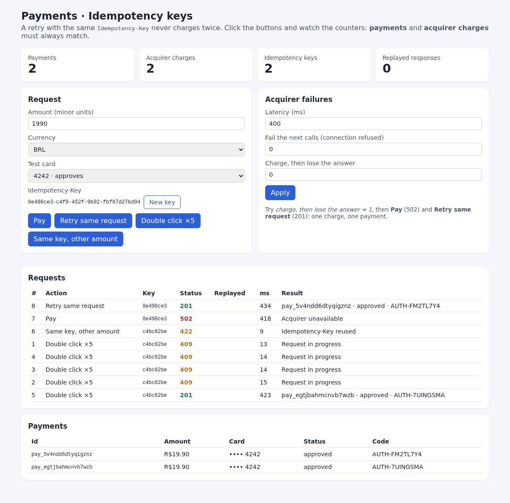
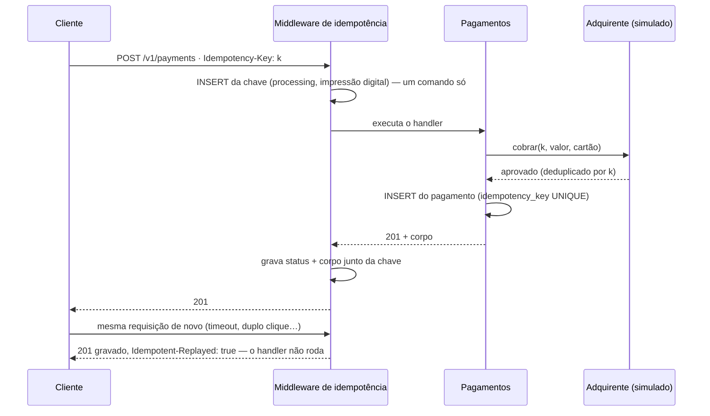

# Pagamentos · Chaves de Idempotência

[](https://github.com/edybackend/payments-idempotency/actions/workflows/ci.yml)
[Read in English](README.md)

Uma API de pagamentos em **Go** em que uma nova tentativa nunca cobra o cartão duas vezes. O cliente envia uma
`Idempotency-Key`, como na API da Stripe:
- o servidor executa a requisição uma vez e depois reproduz a resposta gravada;
- responde `409` enquanto a primeira ainda está rodando;
- recusa a mesma chave com outro corpo (`422`);
- assume a chave de uma requisição que caiu.

A chave também vai para o adquirente (simulado). Se a resposta se perder *depois* que o dinheiro saiu, a nova tentativa
encontra a mesma cobrança. Um painel **React** embutido no binário mostra cada caso com um clique.

Pequeno de propósito: dá para ler em uns 15 minutos e subir com um comando.



## Como rodar

Requisito: Docker.

```bash
docker compose up --build
```

Abra http://localhost:8080. Depois:
- **Double click ×5**: cinco requisições simultâneas, uma execução.
- **Same key, other amount**: `422`.
- Ponha *charge, then lose the answer* = 1, clique **Pay** (`502`) e depois **Retry same request** (`201`). Há uma cobrança, não duas.

<details>
<summary>Sem Docker (Go 1.27 + Node 24)</summary>

```bash
cd web && npm ci && npm run build && cd ..   # opcional: sem isso a API roda e / mostra um aviso
go run ./cmd/payments                        # http://localhost:8080
```

```bash
curl -i -X POST localhost:8080/v1/payments \
  -H 'Content-Type: application/json' -H 'Idempotency-Key: pedido-42' \
  -d '{"amount":1990,"currency":"BRL","card":"4242 4242 4242 4242","description":"Ingresso"}'
# rode de novo → mesmo corpo, cabeçalho "Idempotent-Replayed: true"
```
</details>

## Como funciona



| A chave está… | Resposta |
|---|---|
| nova | executa e grava a resposta |
| concluída, mesma requisição | **reproduz** status e corpo gravados, `Idempotent-Replayed: true` |
| ainda rodando | `409` + `Retry-After: 1` |
| usada com outro corpo | `422`: uma chave pertence a uma requisição (SHA-256 de método, caminho e corpo) |
| presa por uma requisição que morreu (há mais de 30 s) | assumida com compare-and-set e executada |
| ausente | `400` |

Um `5xx` **não** é gravado: a chave é liberada para o cliente tentar de novo. Isso é seguro porque a chamada ao
adquirente leva a mesma chave, e `payments.idempotency_key` é `UNIQUE` como última proteção.

## Os casos e como cada um é testado

| Caso | Teste |
|---|---|
| 20 requisições simultâneas, uma chave → handler roda uma vez | `TestConcurrentRequestsWithOneKeyRunTheHandlerOnce` (`-race`) |
| 10 pagamentos simultâneos, uma chave → 1 pagamento, 1 cobrança | `TestADoubleClickChargesOnce` |
| Cobrou e a resposta se perdeu → `502`; nova tentativa → `201`, ainda 1 cobrança | `TestChargedButTheAnswerWasLost` |
| Adquirente fora duas vezes → `502`, `502`, `201`, 1 cobrança | `TestAnUnreachableAcquirerIs502AndTheRetryWorks` |
| Mesma chave, outro corpo → `422`, handler não roda | `TestSameKeyWithADifferentBodyIs422` |
| Chave presa em *processing* → `409`, assumida depois do timeout | `TestAKeyStuckInProcessingIsTakenOverAfterTheLockTimeout` |
| `5xx` libera a chave | `TestA5xxReleasesTheKeySoTheRetryRunsAgain` |
| No contêiner real | job `container` do CI: 10 requisições simultâneas, cabeçalho de replay, `422`, stats = 1 pagamento / 1 cobrança |

Uma mutação prova que o teste da "resposta perdida" não é decorativo: sem a deduplicação do adquirente, ele encontra 2 cobranças.

## API

| Método | Rota | O que faz |
|---|---|---|
| `POST` | `/v1/payments` | cria um pagamento (exige `Idempotency-Key`) → `201` `approved` ou `declined` |
| `GET` | `/v1/payments`, `/v1/payments/{id}` | pagamentos (só os 4 últimos dígitos) |
| `GET` | `/v1/stats` | pagamentos, cobranças no adquirente, chaves, replays |
| `GET` / `PUT` | `/v1/chaos` | latência do adquirente, falhar as próximas chamadas, cobrar e perder a resposta |
| `GET` | `/healthz` | saúde |

Cartões de teste: `4242 4242 4242 4242` aprova, `4000 0000 0000 0002` é recusado. Valores são inteiros em centavos
(`1990` = 19,90). Erros seguem o RFC 9457 (problem details).

## Tecnologias

| Área | Escolha |
|---|---|
| Back-end | Go 1.27, `net/http` da biblioteca padrão (rotas por método), `log/slog`, `errgroup` |
| Persistência | SQLite via `modernc.org/sqlite` (Go puro, sem CGO); o adquirente tem o próprio banco |
| Front-end | React 19 + TypeScript + Vite, embutido com `go:embed` |
| Qualidade | testes em tabela, `-race`, golangci-lint, gofmt, oxlint |
| Entrega | imagem em 3 estágios (Node → Go → distroless sem root), Docker Compose, GitHub Actions |

## Estrutura

```
cmd/payments/           ponto de entrada: montagem, servidor HTTP, limpeza de chaves, desligamento gracioso
internal/idempotency/   store de chaves + middleware (não sabe nada de pagamentos)
internal/payments/      validação (Luhn), cobrança pelo adquirente, um pagamento por chave
internal/acquirer/      adquirente simulado: deduplica por chave, injeção de falhas
internal/httpapi/       rotas, stats, chave de chaos, painel embutido
internal/problem/       problem details (RFC 9457)
web/                    painel React (compilado em web/dist e embutido)
specs/                  especificações (spec primeiro)
```

## Decisões de design

- **Middleware, não código no handler.** Idempotência é propriedade do endpoint: toda rota POST nova ganha a proteção ao ser envolvida, e um hook recusa as que não forem.
- **Reserva num comando só.** `INSERT … ON CONFLICT DO NOTHING` reserva a chave, e um `UPDATE … WHERE locked_at = ?` assume uma chave vencida. Duas requisições nunca ganham as duas.
- **Impressão digital da requisição.** Reusar a chave para outro pagamento é bug do cliente; reproduzir o outro pagamento esconderia o bug.
- **Não gravar `5xx`.** O servidor não sabe o que aconteceu, então deixa o cliente tentar de novo em vez de congelar um erro.
- **Idempotência de ponta a ponta.** A chave também vai para o adquirente. Idempotência só local não resolve a resposta perdida de um sistema que já agiu.
- **Um binário só.** O painel é embutido com `go:embed`; o contêiner é um build em 3 estágios que termina em distroless.

## Trade-offs conhecidos

- **Chaves globais.** Com autenticação, seriam por cliente (`customer_id + chave`).
- **Timeout do lock × requisição longa.** Uma requisição legítima de mais de 30 s poderia ser assumida enquanto ainda roda. A deduplicação do adquirente e a chave única do pagamento evitam cobrança dupla, mas o timeout deve ficar bem acima do timeout do adquirente (5 s).
- **O replay guarda corpo e status, não todos os cabeçalhos.** O `Location` não é reproduzido.
- **SQLite com uma conexão.** As escritas são serializadas, o que basta aqui; o PostgreSQL usaria os mesmos comandos com lock de linha.

## Engenharia assistida por IA

Este projeto foi construído com o Claude Code sob controles explícitos de engenharia:

- **Regras do projeto** ([`CLAUDE.md`](CLAUDE.md)) definem a estrutura e as regras de pagamento que o agente segue.
- **Hooks** ([`.claude/settings.json`](.claude/settings.json)) rodam `gofmt` em cada mudança, bloqueiam edição de segredos, bancos, lock files e saída de build, **bloqueiam rota POST/PATCH sem o middleware de idempotência**, **bloqueiam log de dados de cartão** e rodam vet, testes com race e o build do painel antes de a tarefa ser dada como pronta.
- **Spec primeiro**: cada funcionalidade começa como especificação em [`specs/`](specs), com critérios de aceite.
- **Os mesmos portões de qualidade para cada linha**: o CI roda gofmt, vet, testes com race, golangci-lint, lint e build do painel, uma execução no contêiner com requisições simultâneas e varredura de segredos.

A arquitetura é minha, e eu reviso cada mudança.

## Licença

[MIT](LICENSE)
